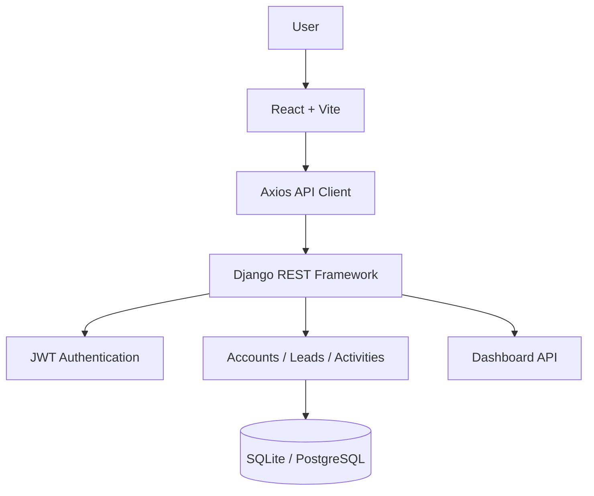

# 🚀 LeadFlow CRM

**A Full-Stack Customer Relationship Management (CRM) Application** built as part of the VyorAI SDE Internship Evaluation.

Manage leads, track sales pipeline stages, schedule follow-ups, and monitor business activities through a dashboard.

<p align="center">


</p>

## ✨ Features

- 🔐 JWT-based Authentication and Authorization.
- 👥 Lead Management (Create, Read, Update, Delete).
- 📊 Sales Pipeline Tracking.
- 📅 Follow-up Scheduling and Management.
- ⏰ Automatic Overdue Follow-up Detection.
- 📈 Dashboard with Live Statistics.
- 🔒 User-Level Data Isolation.
- ✅ Server-Side Validation and Error Handling.

## 🛠 Tech Stack

| Layer | Technology |
|---|---|
| Backend | Python, Django 5.2, Django REST Framework |
| Authentication | SimpleJWT |
| Frontend | React 19, Vite 8 |
| Routing | React Router |
| API Client | Axios |
| Database | SQLite / PostgreSQL |
| Styling | Responsive CSS |

## 🏗 Architecture



## 📁 Project Structure

```text
LeadFlow-CRM/
├── backend/
│   ├── config/
│   ├── accounts/
│   ├── leads/
│   ├── activities/
│   ├── dashboard/
│   └── manage.py
│
├── frontend/
│   └── src/
│       ├── api/
│       ├── components/
│       ├── context/
│       ├── layouts/
│       ├── pages/
│       ├── routes/
│       ├── hooks/
│       └── utils/
│
└── README.md
```

## 🚀 Getting Started

**Prerequisites:** Python 3.12+, Node.js 20+, npm.

### Backend Setup

```bash
cd backend

python -m venv .venv
.venv\Scripts\activate

pip install -r requirements.txt

copy .env.example .env

python manage.py migrate
python manage.py runserver
```

### Frontend Setup

```bash
cd frontend

copy .env.example .env

npm install
npm run dev
```

Frontend: `http://localhost:5173`

Backend: `http://127.0.0.1:8000/api/v1/`

## 🔒 Security Highlights

- JWT authentication with refresh token rotation.
- Secure password hashing using Django PBKDF2.
- User-specific data access and ownership permissions.
- Server-side input validation.
- Protected API endpoints.
- Standardized API error responses.

## 🧪 Testing

| Test | Result |
|---|---|
| Backend automated tests | 42 Passed |
| API smoke tests | 24/24 Passed |
| Frontend production build | Passed |
| Frontend lint | 0 Errors, 1 Warning |

*Browser E2E testing and PostgreSQL integration remain unverified.*

## 🔮 Future Improvements

- [ ] Pagination and advanced filtering.
- [ ] Password reset and email verification.
- [ ] Advanced dashboard analytics.
- [ ] Frontend automated testing.
- [ ] Production deployment.

## 📜 License

Developed as part of the **VyorAI SDE Internship Evaluation**.

---

<p align="center">

**Built with ❤️ using Python, Django REST Framework and React.**

[GitHub Repository](https://github.com/SKM2227229725/LeadFlow-CRM)

</p>